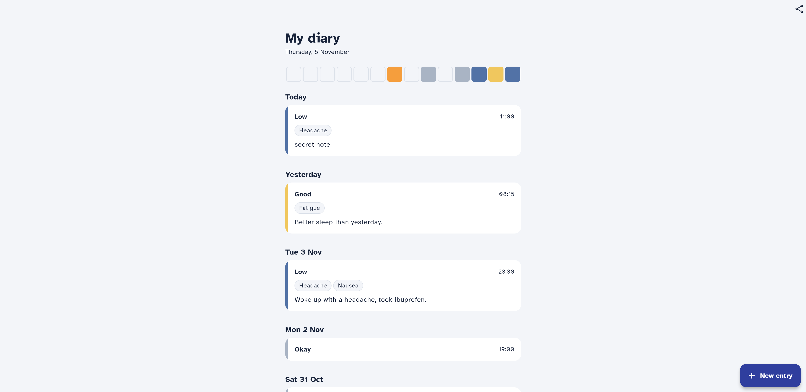
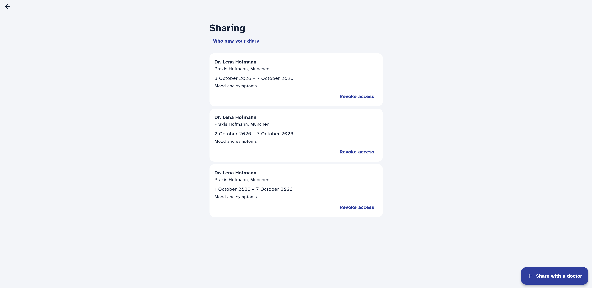
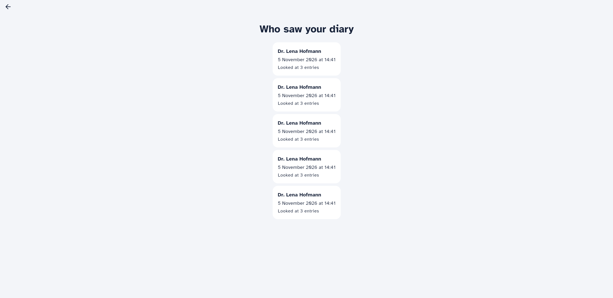
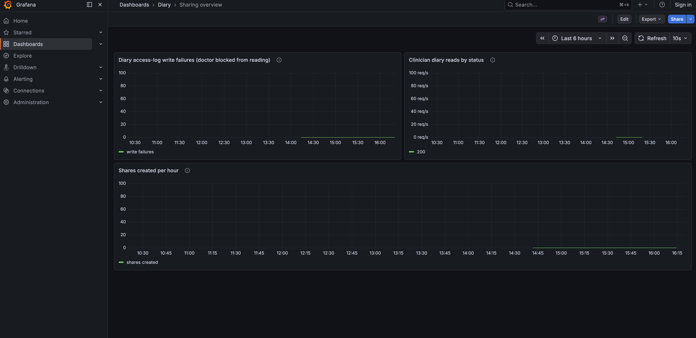

# Notes

Date: 2026-11-05

Timeline:

- 12:33 — Started.
- 12:42–13:04 (22 min) — Paused: a Claude Code tool-permission issue on my machine (not the repo)
  blocked file edits; fixed my own settings and resumed.
- 14:56–15:19 — Ran into overtime on the Flutter screens; finished the frontend here rather than
  cutting it short, but didn't review that code line by line the way I did the backend (see
  "How I used AI").
- 15:19 — Stopped the clock.

Time spent:

- 2h 00min on the 2h budget itself (pause and Flutter overtime excluded).
- 2h 23min including the Flutter overtime, excluding the pause.
- 2h 55min total elapsed from start to finish, including the pause.

I went into overtime with the Flutter part. Building the contents of `app/` took approximately
25 minutes of continuous computation time, so I waited for this single job to finish and did not
apply further adjustments — I do not consider it "work to be graded" for this assignment.
Nonetheless, some screenshots of it are attached (see "Screenshots").

## Assumptions and open questions

- Before starting the feature, found a pre-existing O.Log_4 violation: the request-logging
  middleware in `backend/app/main.py` logged the full raw request body at INFO, which leaked
  health data for `POST /entries` (and would have for the new `POST /shares` too). Fixed by
  dropping the body read and the `body=%s` field from the log call, rather than redacting
  individual fields, since no caller needs the body in logs and a redaction list would rot as
  the schema changes. Verified: `POST /entries` now logs only `METHOD PATH -> STATUS in N ms`.

- No uniqueness constraint on `shares`: a patient can have multiple concurrent, non-revoked
  shares with the same doctor (e.g. overlapping or repeated date ranges). Neither `API.md` nor
  `BRIEF.md` rules this out, so I didn't add one to avoid constraining something that wasn't
  asked for.

- Renamed the autogenerated migration `a61e8acbf10a_add_shares_table.py` to
  `0002_add_shares_table.py` (matching `0001_initial_schema.py`'s naming), and changed its
  `revision` string from the hash to `"0002"`. That migration had already been applied to both
  the dev DB and the test DB (via `make restart` and `make test-api`), so each had
  `a61e8acbf10a` stamped in its `alembic_version` table. After the rename, Alembic could no
  longer find that revision in `alembic/versions/` and `make test` failed for every test with
  `CommandError: Can't locate revision identified by 'a61e8acbf10a'`. Fixed by updating
  `alembic_version.version_num` to `'0002'` directly (`UPDATE alembic_version SET version_num =
  '0002' WHERE version_num = 'a61e8acbf10a';`) in both the `diary` and `diary_test` databases —
  safe here because the table definition itself didn't change, only its revision id. Lesson:
  renaming an already-applied migration's revision id must be paired with re-stamping
  `alembic_version` everywhere it was applied, in the same step.

- Merged the separate `shares` and `access_logs` table migrations into one file
  (`0002_add_shares_and_access_log_tables.py`, revision `"0002"`) since both were written in the
  same session and hadn't been shared outside it — one migration for "add the sharing feature's
  tables" reads cleaner than two. Both DBs were already stamped `0002` (with `shares` created,
  `access_logs` not yet), so merging didn't change what Alembic thinks is applied; I created
  `access_logs` directly via SQL to match, rather than downgrading/upgrading, since the DBs
  already matched everything else the merged migration defines.

- `POST /shares` endpoint decisions (`backend/app/api.py`): an unknown `clinician_id` returns
  `422` (covered by `API.md`'s general "invalid input returns 422"); `to_date < from_date`
  returns `422` via a Pydantic validator on `ShareIn` rather than letting the DB's
  `share_date_range` CheckConstraint raise a raw `IntegrityError`/500.
- `POST /shares/{id}/revoke`: revoking a share that doesn't exist, or that belongs to another
  patient, both return `404` — I made them indistinguishable as a conservative default (not
  required by any doc, but avoids leaking which share ids exist for other patients). Revoke is
  idempotent: calling it again on an already-revoked share returns its existing state unchanged,
  not an error.
- `consent_version` is never set explicitly by `POST /shares` — it relies on `Share`'s
  `server_default="v1"`, so O.Cons_3 is covered at the model layer without endpoint code.

- `GET /clinician/patients/{id}/entries` (`backend/app/api.py`): "no such patient" and "not
  shared with you" (never shared, or revoked) all return `200` with `[]` — the same response as
  a genuinely valid share that happens to cover no entries. `API.md` documents no error response
  for this endpoint, so there's no undocumented status code to add, and it trivially satisfies
  "a clinician must not be able to tell those apart" since there's nothing to distinguish. This
  falls out of the query itself: `Share.patient_id` has an FK to `patients`, so a nonexistent
  patient can never have an active share — no separate "does the patient exist" check needed.
- Multiple active shares from the same clinician to the same patient (allowed, since `shares` has
  no uniqueness constraint) are unioned: an entry is visible if its local calendar date falls
  within _any_ active share's range; its note is included if _any_ covering active share has
  `include_notes=true`. Not specified anywhere, but a direct consequence of allowing concurrent
  shares — some rule was needed, and "most permissive applicable grant wins" seemed the least
  surprising to a patient who created multiple shares on purpose.
- Calendar-day matching: for `source != "app-v1"` entries, `recorded_at` (a true UTC instant) is
  converted to the patient's local date via `zoneinfo.ZoneInfo(patient.timezone)`. For
  `source == "app-v1"` entries, `recorded_at.date()` is used directly with no conversion, since
  those rows' local wall-clock time was stored mislabelled as UTC (`BRIEF.md`, Tom). Tested by
  constructing an entry whose UTC and Berlin-local dates differ.
- O.Mon_1 (alert on a failed access record): wrapped the `AccessLog` insert in try/except;
  on failure it increments `access_log_write_failures_total` (an unlabelled Prometheus counter —
  no patient/clinician id, per the hard constraint on metric labels) and logs one generic ERROR
  line with no ids or health data. The request then **fails closed**: `503`, no entries
  returned, rather than disclosing health data that couldn't be proven audited. This trades
  availability (a doctor blocked right before an appointment during a DB blip — `BRIEF.md`,
  Lukas) for audit integrity; tested by monkeypatching `Session.commit` to fail and asserting a
  `503` with no entries and the counter incrementing.
- Reused the existing `EntryOut` schema for this endpoint's response instead of adding a new one,
  since `API.md`'s shape for it (`id`, `recorded_at`, `mood`, `symptoms`, `note`) is identical.

## Data model decisions

- `shares` table (`backend/app/models.py`): `patient_id`/`clinician_id` as FKs, `from_date`/
  `to_date` as plain `Date` columns (calendar days, no time component) — the patient-timezone
  conversion happens when matching diary entries to the range, not when storing the share, since
  the share itself is just "these calendar days" per `BRIEF.md`. `include_notes` defaults to
  `false`. `revoked_at` nullable, set on revoke, never deleted (keeps the row as evidence of what
  was shared and for how long).
- Added `consent_version` to `shares`: an internal-only column (not in any `API.md` response),
  recording the wording version the patient agreed to when creating the share, for O.Cons_3. The
  share row itself is treated as the consent record: it's valid (grants access) exactly while
  `revoked_at IS NULL`, and captures exactly what was consented to (clinician, date range,
  whether notes are included) per O.Cons_1.
- `access_logs` table (`backend/app/models.py`): `patient_id`/`clinician_id` FKs, `accessed_at`,
  and `entry_ids` (the specific entries returned, frozen at access time — later edits or
  re-sharing can't retroactively change what a past access record shows). One row per successful
  `GET /clinician/patients/{id}/entries` call, including when it returns zero entries
  (`entry_ids = []`): O.Log_1 says "every access", and the patient should see every time the
  doctor opened the diary, not just the ones that returned content.
- O.Log_3 ("protected against modification") is enforced for `access_logs` at the app level only:
  no endpoint or code path in this app issues `UPDATE`/`DELETE` against it. There is no
  database-level enforcement (no `REVOKE`, no trigger) — confirmed with `\dp access_logs` on the
  dev DB, which shows the default (empty) privilege set, i.e. the `diary` role can still
  `UPDATE`/`DELETE` the table directly. Chosen over DB-level enforcement (e.g. revoking
  `UPDATE`/`DELETE` from the app's role) because that needs a privilege-separated DB role, which
  the current single-role docker-compose setup doesn't have; adding one is a reasonable next
  step but out of scope for this timebox. This requirement doesn't apply to `shares`: that table
  is intentionally mutable (revoking a share is an `UPDATE` of `revoked_at`).

## Requirements

| ID | Applies? | Where it is met (code, test), or why not |
| --- | --- | --- |
| O.Purp_1 | Yes | Met by `ShareScreen`'s review step (`app/lib/share_screen.dart`): before `POST /shares` is called, it shows the recipient (clinician name + practice), the data categories ("Mood and symptoms" or "Mood, symptoms and notes"), and the period, with an explicit "Review and share" step before the final "Share diary" confirm. **`ShareScreen` is a frontend element from the Flutter overtime work (see header) — not reviewed by me; included here only for completeness.** |
| O.Cons_1 | Yes | A share only grants access while `revoked_at IS NULL`, and scopes exactly what was consented to (clinician, date range, `include_notes`). Enforced live on every read: `GET /clinician/patients/{id}/entries` queries `revoked_at IS NULL` directly, no caching. |
| O.Cons_2 | Yes | Revoking sets `revoked_at` immediately (`POST /shares/{id}/revoke`); there's no caching of share validity, so every subsequent access check reads current DB state — a withdrawal takes effect for every access from that point on. |
| O.Cons_3 | Yes | `shares.consent_version` (internal, not in the API response) records the consent wording version at creation time. See "Data model decisions". |
| O.Auth_1 | Yes | Not met. The auth stub (`backend/app/auth.py`) is `Bearer <role>-<id>` with no session or login timestamp at all, so there is no "last authenticated" moment to check against 15 minutes. Implementing real re-auth would mean building a session/login system that's explicitly out of scope ("real authentication is out of scope", `auth.py`). |
| O.Pass_1 | No | Doesn't apply: this system has no passwords anywhere. Auth is a stub (`Bearer <role>-<id>`), explicitly out of scope ("real authentication is out of scope", `auth.py`); there's no login/credential flow for a password policy to govern. |
| O.Log_1 | Yes | `GET /clinician/patients/{id}/entries` writes an `access_logs` row (accessing clinician, entries actually returned, time) on every successful read where a valid share existed, including zero-entry reads. See `test_clinician_access.py`. |
| O.Log_2 | Yes | `GET /access-log`, scoped to the authenticated patient. See `test_clinician_access.py::test_access_log_records_clinician_access_with_entry_ids`. |
| O.Log_3 | Yes | App-level only: no code path updates/deletes `access_logs` rows. No DB-level enforcement (no `REVOKE`, no trigger) — see "Data model decisions" for why. |
| O.Log_4 | Yes | Was violated: request-logging middleware (`backend/app/main.py`, `log_requests`) logged the full request body, leaking `mood`/`symptoms`/`note`. Fixed by removing the body read and the `body=%s` log field. Residual gap found on a later self-review, not fixed before submission: the same log line still uses `request.url.path` (the raw path) rather than the route template, so `GET /clinician/patients/{patient_id}/entries` logs the literal `patient_id` on every call — the metric two lines below it already uses the route template (`request.scope["route"].path`) and doesn't have this problem. A patient id isn't a "name or email address" per `REQUIREMENTS.md`'s own examples, but it's in tension with `CLAUDE.md`'s stricter "no direct identifiers in application logs." See "Next steps". |
| O.Mon_1 | Yes | `access_log_write_failures_total` counter increments and the request fails closed (`503`) if the `AccessLog` insert fails; graphed on the "Sharing overview" Grafana dashboard. See "Data model decisions", `test_fails_closed_when_access_log_write_fails`, and "Monitoring" below. |
| O.Err_1 | Yes | FastAPI runs with `debug=False` (the default; never set otherwise), so unhandled exceptions get Starlette's generic 500 body, not a traceback/SQL/file path. Regression-tested in `test_error_handling.py::test_unhandled_error_does_not_leak_internals` by forcing an unexpected `RuntimeError` inside an endpoint and asserting the response body contains none of it. |
| O.Cryp_1 | Yes | Not met in this dev setup. In production this is normally satisfied at the managed-disk/DB layer (e.g. the cloud provider's encrypted volumes for the Postgres instance), which is an infra/deployment concern outside this repo's local `docker-compose.yml` (plain `postgres:16-alpine`, no encryption configured) and outside the application code. See "Erasure" below for a related note on column-level alternatives I considered and didn't build. |
| O.Del_1 | Yes | Stretch goal, not built. See "Erasure" below for how I would do it. |
| O.Doc_1 | Yes | Met by this table: every requirement in `REQUIREMENTS.md` is assessed here for applicability and, where it applies, where it's met or why not. |

## Erasure (O.Del_1): how I would do it

Dr. Keller's objection ("that's our evidence if something goes wrong clinically") and Mara's
instruction ("don't build anything that makes it impossible") point at the same resolution:
erase the patient's health data and consent records, but keep the audit trail — with the direct
identifiers stripped from it — using the existing legal retention duty (O.Log_3's ten years) as
the lawful basis for not deleting that specific evidence (this mirrors GDPR Art. 17(3)(b): the
right to erasure doesn't override data kept to comply with a separate legal obligation).

Concretely, on an erasure request for a patient:
1. `DELETE FROM diary_entries WHERE patient_id = ?` and `DELETE FROM shares WHERE patient_id = ?`
   — the health data and consent records are gone outright; nothing requires keeping them.
2. Pseudonymize the `patients` row in place rather than deleting it (`name`, `email` overwritten,
   e.g. `'Erased patient'` / `erased-<id>@deleted.invalid`; `timezone`/`id` kept) instead of
   deleting it outright, because `access_logs.patient_id` has a foreign key to it — deleting the
   row would either cascade-delete the audit evidence (defeating the point) or fail outright.
   `access_logs` rows themselves are left untouched: they never held health data or free text to
   begin with (just `clinician_id`, `accessed_at`, `entry_ids`), so there's nothing further to
   strip from them, and `entry_ids` pointing at now-deleted entries is fine for a historical
   audit pointer.
3. None of this requires a schema change — the current FK (`access_logs.patient_id` references
   `patients`, not `diary_entries`) was already chosen with this in mind, confirming Mara's
   requirement is satisfiable without today's schema getting in the way.

**Trigger model, decided but not built:** a self-service `DELETE /me`, callable by the
authenticated patient (`current_patient`), doing exactly the three steps above and returning
`204`. Chosen over gating it behind a new "support/admin" role because the auth stub only has
`patient`/`clinician` — adding a third role just to demo this stretch goal would be scaffolding
for the sake of scaffolding, not something the feature itself needs. The trade-off: a real
production version almost certainly shouldn't let one unauthenticated-in-any-stronger-sense
bearer token irreversibly erase an account in a single call — it should sit behind identity
re-verification and probably a support/compliance review step, exactly the kind of thing O.Auth_1
would normally require ("re-authenticate if last authentication is older than 15 minutes") if
this auth system had a real login to re-check. I'm choosing to demonstrate the erasure mechanism
itself (what gets deleted vs. pseudonymized vs. kept, and why) rather than building a parallel
admin/support auth system that's out of scope for what this feature needs.

Not built — not even the endpoint — because the step after this write-up is still "describe it,"
per `BRIEF.md` ("let's not build erasure in this iteration... please don't build anything that
makes it impossible... write down how you would do it"). See "Next steps" for what actually
implementing `DELETE /me` would involve.

## Monitoring

On-call (Lukas) — "tell me what to measure, what wakes me up, what waits, how I see it on fire":

- **Primary, pages immediately:** `access_log_write_failures_total` (added this session). Any
  increase means O.Log_1 couldn't be satisfied and, per the fail-closed design, a doctor was
  just blocked from opening a diary — this is deliberately a direct, specific signal with no
  judgement calls needed about thresholds: _any_ increase is actionable right now.
- **Secondary, pages on sustained increase:** 5xx rate on
  `GET /clinician/patients/{patient_id}/entries`, from the existing `http_requests_total{route,
  status}` counter (no new metric needed — route is a path template, not a patient id, so this
  was already label-safe). Catches failures upstream of the access-log write (e.g. the DB being
  down entirely). A single 5xx isn't worth a page; several within a few minutes is.
- **Not actionable, don't page:** `403` (wrong role token) and `200` with `[]` (no valid share,
  or a share with nothing in range) on that same route — both are normal, expected outcomes of
  clinicians using the system, not failures.
- **"See what's going on when it's on fire":** the new
  `observability/dashboards/sharing-overview.json` Grafana dashboard (`make observe`, then
  `localhost:28003`, folder "Diary") — write-failures
  panel, a by-status breakdown of the clinician-read route, and the existing `api-overview`
  dashboard's general latency/error panels for broader context. Both read from the same
  `/metrics` Prometheus already scrapes (`observability/prometheus.yml`); production would wire
  the same counters into Datadog per the repo's existing comment that "production uses Datadog."

Product (Mara) — "do patients use sharing, and do the ones who share keep logging?":

- **Adoption** (do patients use it): "Shares created per hour" panel on the same dashboard,
  built from the existing `http_requests_total{route="/shares", method="POST", status="201"}`
  counter — no new metric needed. This is an aggregate trend (count of share-creation events
  over time), not a distinct-patient count, because patient ids can't be metric labels.
- **Retention** (do sharers keep logging): deliberately **not** a live metric. It's a per-patient
  cohort comparison — diary-entry rate for patients who created a share vs. those who didn't,
  before/after their first share — which needs patient-level join logic a Prometheus counter
  can't express (and patient ids can't be metric labels regardless). This is a periodic
  analytical query against the database instead, e.g. comparing weekly `diary_entries` counts
  per patient in the 4 weeks before vs. after their first `shares` row, against the same window
  for patients with no shares at all. Recommended cadence: first check after ~4-6 weeks (enough
  patients will have both a share and enough days-after to compare), then again near the
  3-month mark when Mara needs to report out — a product-review cadence, not something to page
  on.

## Screenshots

Added by hand after manually verifying the app in the browser. **The sharing screens shown here
are the Flutter overtime work (see header) — not reviewed by me line by line; shown only for
completeness, not as reviewed work.** The Grafana dashboard screenshot shows
`observability/dashboards/sharing-overview.json`, which is backend-side config I did review.

_"My diary"_ — entry point to sharing: the share icon top-right opens the "Sharing" screen.

_"Sharing"_ — three active shares with Dr. Lena Hofmann (created with different `from_date`s
during testing), each showing the doctor, period, data categories, and a "Revoke access" action;
"Who saw your diary" link and the "Share with a doctor" FAB.

_"Who saw your diary"_ (O.Log_2) — five access records from Dr. Lena Hofmann. All five share a
timestamp because they're from a burst of test `curl` calls made in quick succession; each read
still correctly produced its own audit row (O.Log_1).

_Grafana "Sharing overview"_ — the on-call and product panels with real data from the test
traffic: access-log write failures flat at zero, clinician reads by status, and shares created
per hour.

## How I used AI

Tools, workflow, and where you corrected the agent. Session transcripts are welcome but optional.

**Tool:** Claude Code (CLI), running Claude Sonnet 5, for the whole feature — backend, Flutter,
the Grafana dashboard, and this file. No other AI tool used.

**Workflow:** I had it read `README.md`/`BRIEF.md`/`API.md`/`REQUIREMENTS.md`/`DESIGN.md` first
and give me a short overview before touching anything, matching `CLAUDE.md`'s instructions in
this repo. From there we went one step at a time: for each piece (the O.Log_4 fix, the `shares`
table, the `access_log` table, the patient endpoints, the clinician endpoint, the remaining
requirements, the monitoring signals, the Flutter screens, erasure), it stated a short plan
before changing anything, and — important for how I actually used it — whenever the docs left a
real design choice open (consent-version storage, the "no such patient" vs. "not shared with you"
response, fail-open vs. fail-closed on an audit-write failure, the erasure trigger model, and
others) it stopped and gave me the trade-offs as an explicit choice instead of picking silently.
I made those calls; they're recorded throughout "Assumptions and open questions" and the
requirements table with my reasoning attached, not just the outcome.

Tests were written alongside each change, not after — for the trickier ones (the request-body
logging fix, the fail-closed access-log write, the timezone/`app-v1` bucketing) it deliberately
broke the fix, showed me the test catching the regression, then restored it, rather than me
having to trust an untested claim. I used it the same way for documentation: `NOTES.md` was
built up incrementally as we went, not written at the end from memory.

Backend code I reviewed and directed step by step, the way described above. The Flutter screens
were a different workflow — see below — and the dashboard JSON and this log file were generated
directly from what we'd already agreed on, not independently designed by the model.

- Corrected the agent: it renamed the autogenerated migration file/revision id
  (`a61e8acbf10a` → `0002`) to match the repo's `000N_name.py` convention, but didn't re-stamp
  `alembic_version` in the databases that had already applied it, breaking `make test`. I ran
  `make test` myself, saw the `CommandError`, and had it diagnose and fix the mismatch (see
  "Assumptions and open questions"). Lesson applied going forward: re-stamp every DB in the same
  step as renaming an already-applied revision.

- **Flutter (`app/lib/access_log_screen.dart`, `sharing_screen.dart`, `share_screen.dart`, and
  the sharing-related additions to `models.dart`/`api.dart`/`widgets.dart`/`diary_screen.dart`):
  I did not manually review this code line by line — it was generated in one pass and I ran out
  of time (overtime already, past the 2h mark excluding the setup pause) to go through it the
  way I did for the backend. I did verify behaviour, not just read code: `flutter analyze` and
  `flutter test` both pass (including new widget tests), and I clicked through the actual app in
  the browser (share creation with the consent-review step, revoke, empty/non-empty access log).
  Two real bugs surfaced only through that testing, not from reading the diff (a `setState`
  callback that returned a `Future` from an assignment-expression arrow closure, and a test
  fixture encoding bug) — both were root-caused and fixed, with the fixes verified by rerunning
  the tests. But I cannot personally vouch for this code the way I can for the backend, where I
  reviewed and reasoned through each step before accepting it. **Please treat
  `app/lib/*sharing*`, `app/lib/access_log_screen.dart`, and the sharing-related diffs to
  `models.dart`/`api.dart`/`widgets.dart`/`diary_screen.dart` as unreviewed by me, and exclude
  them when assessing how well I can explain my own submission** — ask me about the backend
  instead, which I did go through properly.

## Next steps

In rough priority order:

1. **Manually review the Flutter sharing screens.** The single biggest gap: `access_log_screen
   .dart`, `sharing_screen.dart`, `share_screen.dart`, and the sharing-related diffs to
   `models.dart`/`api.dart`/`widgets.dart`/`diary_screen.dart` were generated in one pass without
   my line-by-line review (see "How I used AI"). Behaviour is verified (tests pass, I clicked
   through the app), but I want to actually read it the way I read the backend before I'd call it
   done.

2. **Implement `DELETE /me` (O.Del_1)**, per the trigger model decided above: `current_patient`-
   gated, deletes `diary_entries`/`shares` for that patient, pseudonymizes the `patients` row
   (`name`, `email`), leaves `access_logs` untouched, returns `204`. No migration needed — the
   schema already supports this. Tests: entries/shares gone after the call; the patient's prior
   `access_logs` rows (and their `entry_ids`) still exist and still resolve a (now pseudonymized)
   `clinician_name`/patient association; calling it twice doesn't error.

3. **Fix the request-log line in `log_requests` (`backend/app/main.py`) to log the route template
   instead of `request.url.path`**, matching what the `REQUESTS`/`LATENCY` metrics on the same
   line already do (`request.scope["route"].path`). Found on a later self-review (see the O.Log_4
   row above); small, low-risk change, but not made before submission since it surfaced after the
   timer stopped.

4. **Screenshots.** Added under "Screenshots" above: the sharing screens (list, create/review,
   access log — the Flutter overtime work, not reviewed by me, included for completeness only)
   and the Grafana "Sharing overview" dashboard, per the submission checklist in `README.md`.

5. **DB-level enforcement for `access_logs`** (O.Log_3): add a second, privilege-separated
   Postgres role that the app connects as for everything except this table, and `REVOKE UPDATE,
   DELETE` from it there — currently only enforced by "no code path does this," not by Postgres
   itself. Needs its own `docker-compose.yml`/migration work, deliberately deferred this session
   (see "Data model decisions").

6. **O.Auth_1 and O.Pass_1** can't be meaningfully implemented without a real login/session
   system, which is explicitly out of scope for this auth stub. If this feature went further than
   a take-home, the right order would be: build real authentication first, then O.Auth_1's
   15-minute re-auth check becomes meaningful (and so does gating `DELETE /me` behind it).

7. **O.Cryp_1** (encryption at rest): confirm with whoever provisions the production database
   that the managed Postgres instance's disk is encrypted (this is normally a checkbox at the
   cloud-provider level, not application code). If column-level encryption inside Postgres were
   additionally required (e.g. via `pgcrypto`), `mood`/`symptoms`/`note` on `diary_entries` would
   be the columns to encrypt — at the cost of losing the ability to query/index on them directly.

8. **Retention analysis for the product monitoring signal** (see "Monitoring"): the actual
   cohort query comparing diary-entry rates for patients who share vs. don't, run once there's
   enough real usage data (recommended first look: ~4-6 weeks in).
